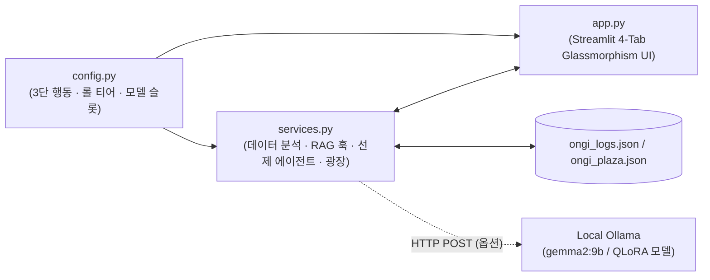

# 🌿 ONGI MVP v2.0 — 포지티브 사회적 기여(SPC) 기반 AI 웰빙 & 성장 대시보드

> **타인과의 네거티브 비교·사치품 과시를 넘어, 어제의 나보다 조금 더 다정한 실천을 사회적 자본(SPC: Social Positive Capital)으로 축적하는 로컬 AI 자기성장 프로토타입(v2.0)**

---

## 1. 프로젝트 소개 및 핵심 철학

현대 디지털 서비스와 SNS는 흔히 **랭킹·스펙·사치품 중심의 네거티브 비교**를 유도해 사용자의 자존감과 일상의 만족도를 떨어뜨립니다. **ONGI(온기)**는 이 구조를 뒤집기 위해 설계된 **비경쟁·포지티브 성장 플랫폼 MVP**입니다.

- **SPC(Social Positive Capital) 생태계**: 타인과 순위를 겨루는 대신, 매일의 마음 상태(행복·에너지)와 선한 실천을 나만의 긍정 자본(`SPC`)으로 축적합니다.
- **생애 주기·직종별 맞춤 가중치 모델링**:
  - `어린이/유치원`, `초/중/고등학생`부터 `20대~90대`까지 전 생애 주기와 현재 상태에 맞춰 권장 포지티브 행동과 보너스(`+5 SPC`)를 제공합니다.
  - 특히 **`공직/공공기관`**(`보이지 않는 곳에서의 성실한 업무·공익 기여`, `+20 + 8 SPC`)이나 **`보건/돌봄·복지`** 등 수직적이거나 지치기 쉬운 환경의 보이지 않는 헌신을 공정하게 인정합니다.
- **장기 성장 재미(롤 티어 + 일일 무한 레벨)**: 30일 만에 만렙이 되지 않도록 `🌱 브론즈(씨앗 IV)`부터 `🌍 챌린저(그랜드 온기 거장)`까지 **7단계 티어 & 세부 디비전(IV~I) + LP 게이지**와 **일일 무한 레벨(`Lv. 1 → 2 → ...`) + 연속 기록(`🔥 N일 연속`)**을 결합했습니다.

---

## 2. 주요 기능 (4개 핵심 탭 구조)

가독성이 뛰어난 **밝은 글래스모피즘(Light Glassmorphism)** UI와 **상단 4개 핵심 탭**으로 스크롤을 줄이고 직관성을 극대화했습니다.

| 탭 | 핵심 기능 |
| :--- | :--- |
| **🌱 탭 1. 오늘의 온기 기록** | • 행복·에너지(1~10점) 슬라이더 및 한 줄 감정 메모<br>• **3단 카테고리 포지티브 행동 선택**:<br>  ① `☀️ 일상의 사소한 온기` (밝은 인사·배려·감사·선플·지구 아끼기 5종)<br>  ② `🤝 세부 봉사 템플릿` (연탄 나눔·유기견 돌봄·무료급식·멘토링·디지털 길잡이·플로깅·헌혈 7종)<br>  ③ `📚 자기계발 & 직종별 맞춤 공헌` (지식 학습·운동·공직/IT 등 특화 행동)<br>• 저장 즉시 로컬 AI가 건네는 **ONGI의 한마디** |
| **🧭 탭 2. 행복 나침반 & 10년 시뮬레이터** | • **AI 행복 나침반**: 내 행복 확률을 가장 크게 높인 1위 행동·상승률(%)·고행복 확률(%)·기대 온기 지수 분석<br>• **나의 온기 흐름**: 최근 30일 행복·에너지 및 누적 SPC 추이 차트<br>• **1개월·1년·5년·10년 장기 복리 시뮬레이터**: 시간순(`1개월→1년→2년→…→10년`) Altair 우상향 차트 및 성장 칭호 예측<br>• **SPC 사회적 가치 환산소** (`🔥 전달된 연탄`, `🐶 유기동물·이웃 돌봄 시간`, `👋 사소한 인사와 미소`) & **포지티브 명예 배지 6종**<br>• **💰 현실 자산 & SPC 융합 시뮬레이터**: 월 수입·주거비·생활비·변수 비용 기반 1개월~10년 누적 자산 예측 + SPC 사회적 신뢰 자본(우대 금리·인센티브) 융합 총가치 & 다정한 AI 소비 코칭 |
| **💬 탭 3. AI 온기 파트너 (코칭 & 채팅)** | • **양방향 AI 온기 대화방**: 현재 프로필·30일 행복 통계·**자산/주거비 소비 밸런스**까지 기억하고 대화하는 로컬 Ollama(`gemma2:9b`) 채팅 (오프라인 통계 맞춤 응답 지원)<br>• **선제적 안부 에이전트 배너**: 최근 3일 행복·에너지가 처졌을 때 과거 행복 1위 행동을 먼저 역제안<br>• **원클릭 AI 월간 심층 리포트**: 누적 통계·추세·RAG 참고 지식을 결합한 3문단 맞춤 코칭 편지 |
| **🌐 탭 4. 온기 광장 (포지티브 SNS)** | • **🌡️ 우리 사회 온기 온도계 (°C)**: 대한민국 공동체 누적 SPC 게이지<br>• **이웃 타임라인**: 다양한 직종·연령대 이웃들의 선한 실천 공유 + 작성자 옆 미니 롤 티어·레벨 태그(`[🔥 플래티넘 II · Lv.142]`)<br>• **3종 리액션 연동**: `🔥 온기 더하기`, `👏 보이지 않는 노력 응원`, `🌱 나도 동참할래요` 클릭 시 게시글 온기·나의 SPC(`+3 SPC`)·공동체 온도계 동시 상승 |
| **🧪 사이드바 도구** | • 컴팩트 프로필 + **롤 티어 & 일일 레벨·연속 기록 통합 유리 카드**<br>• `🧪 최근 30일 샘플 데이터 채우기` · `🗑️ 기록 초기화` · `📥 내 기록 CSV 다운로드` |

---

## 3. 3-File 아키텍처 구조도

```text
ongi/
├── .streamlit/
│   └── config.toml      # 라이트 테마 기본값 및 코랄 오렌지 포인트 컬러 고정
├── config.py            # 도메인 상수, 3단 포지티브 행동, 롤 티어, 파인튜닝 모델 슬롯, 테마 팔레트
├── services.py          # JSON 영속화, SPC·티어 계산, 6개월 로드맵 확장 슬롯 4종, 시뮬레이터, 온기 광장, CSV
├── app.py               # Streamlit 4-Tab 라이트 글래스모피즘 UI 및 세션 상태 오케스트레이션
├── requirements.txt     # 실행 의존성 목록 (streamlit, pandas, altair)
└── README.md            # 프로젝트 문서 및 6개월 고도화 가이드
```



---

## 4. 6개월 LLM 엔지니어 과정 로드맵 & 코드 확장 슬롯

앞으로 6개월 과정에서 학습할 기술을 기존 UI를 건드리지 않고 **레고 블록처럼 갈아끼울 수 있도록** 4개의 확장 슬롯을 코드에 명시적으로 분리해 두었습니다.

| 로드맵 시기 | 학습 및 고도화 목표 | 코드 연결 위치 (확장 슬롯) | 교체 / 확장 방법 |
| :--- | :--- | :--- | :--- |
| **1~2개월 차**<br>(데이터 분석) | 행동-행복 상관관계 및 예측 확률 고도화 | `services.py`<br>`analyze_happiness_compass()` | 현재 기술통계 기반 상승률·확률 로직을 **Pandas 상관계수(`df.corr()`)** 또는 **Scikit-learn 회귀·분류 모델 Feature Importance**로 교체 |
| **3~4개월 차 A**<br>(RAG 연동) | 심리 회복 가이드 및 지역 봉사(강남구 가족센터 등) 문서 검색 | `services.py`<br>`retrieve_rag_context()` | 외부 심리·지역 봉사 문서를 **Chroma / FAISS 벡터 DB**에 인덱싱하고, 이 훅 함수에서 Top-K 검색 결과를 반환하도록 연결 (리포트·채팅에 자동 주입) |
| **3~4개월 차 B**<br>(파인튜닝 모델) | 공감·비경쟁 코칭 특화 QLoRA 모델 서빙 | `config.py`<br>`FINETUNED_OLLAMA_MODEL_NAME` | 직접 **QLoRA로 파인튜닝해 Ollama에 등록한 모델명**을 변수 1줄에 입력하면 앱 전체 LLM 추론 모델 즉시 교체 |
| **5~6개월 차**<br>(멀티 에이전트) | 감정 저하 시 선제적(Proactive) 역제안 워크플로 | `services.py`<br>`evaluate_proactive_agent_nudge()` | 현재 규칙 기반 저하 감지 함수를 **LangGraph 멀티 에이전트**(감정 감지 → 행동 설계 → 회고 코치) 그래프 진입점으로 확장 |

---

## 5. 실행 방법

```bash
# 1) 의존성 설치
pip install -r requirements.txt

# 2) 앱 실행
streamlit run app.py

# 3) (선택) 로컬 Ollama 연동
ollama run gemma2:9b
```
